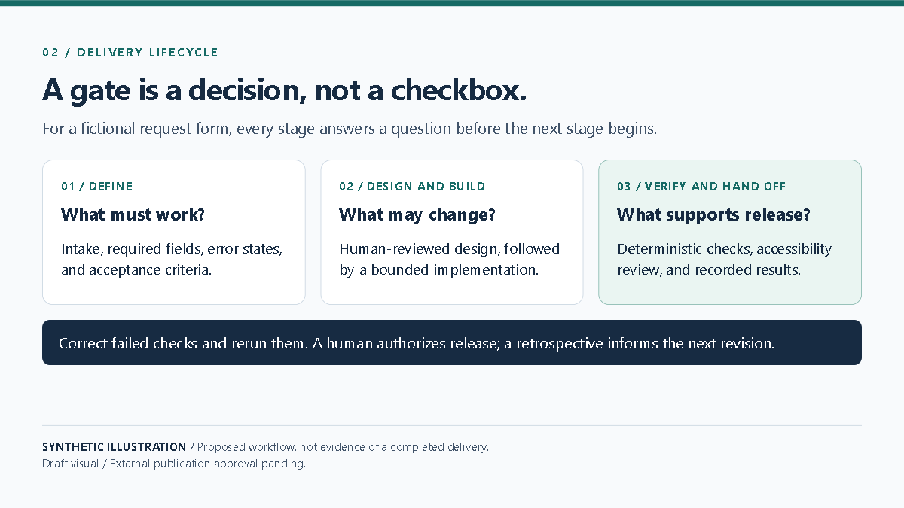

# Designing the Delivery Lifecycle

A reliable delivery lifecycle makes the next decision visible. It begins with intake and acceptance criteria, proceeds through architecture and implementation, and ends with validation, handoff, and retrospective. Stage gates are not paperwork for its own sake: they clarify who can approve a decision and what evidence is needed before moving forward.

For a synthetic request-form example, the team first defines required fields and error states. A human reviews the architecture before implementation. Deterministic checks and accessibility tests run before a human release decision. After handoff, a retrospective records what should change in the reusable standard.

The process is deliberately small. A stage can be tailored when risk is low, but security, accessibility, privacy, and human accountability are not silently skipped. The example describes a proposed workflow, not evidence that a real team used or completed it.

**Limitation:** This lifecycle is a reusable starting point, not a substitute for solution-specific risk analysis or required governance decisions.

**Visual:** Playwright capture EVD-BLOG-002; [source and capture notes](assets/README.md).

**Caption:** Proposed synthetic lifecycle with explicit stage decisions, correction, and human release authority.

**Source note:** Original synthetic diagram in this repository; external publication approval pending.
