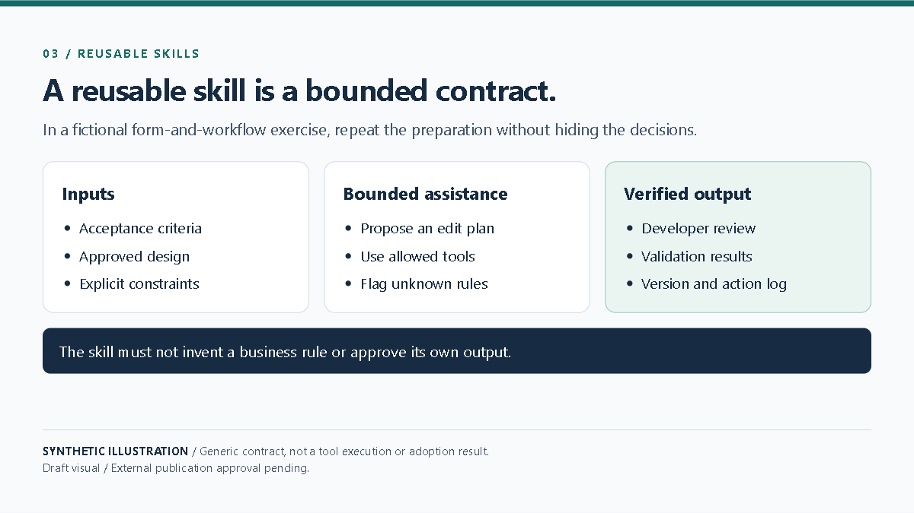

# Reusable Skills for Low-Code Delivery

A reusable skill is a bounded contract, not a prompt that claims to build anything. It should state when to use it, what inputs it expects, which platform tools are allowed, what constraints apply, and how a person verifies the result.

In a fictional form-and-workflow exercise, a skill could help a developer turn acceptance criteria into a proposed edit plan. The developer checks that the plan matches the approved design, applies changes in a safe environment, and runs the required validation. The skill must not invent a business rule or approve its own output.

Reusable instructions are most useful when they reduce repeated setup without hiding decisions. Record the standard version, tool actions, human review, and validation result. This article does not claim that any pilot used a skill or achieved a measured productivity gain.

**Limitation:** A skill cannot verify every platform or environment condition and must not replace developer review or release checks.

**Visual:** Playwright capture EVD-BLOG-003; [source and capture notes](assets/README.md).

**Caption:** Generic synthetic skill contract; no execution or independent adoption is claimed.

**Source note:** Original synthetic diagram and example in this repository; external publication approval pending.
