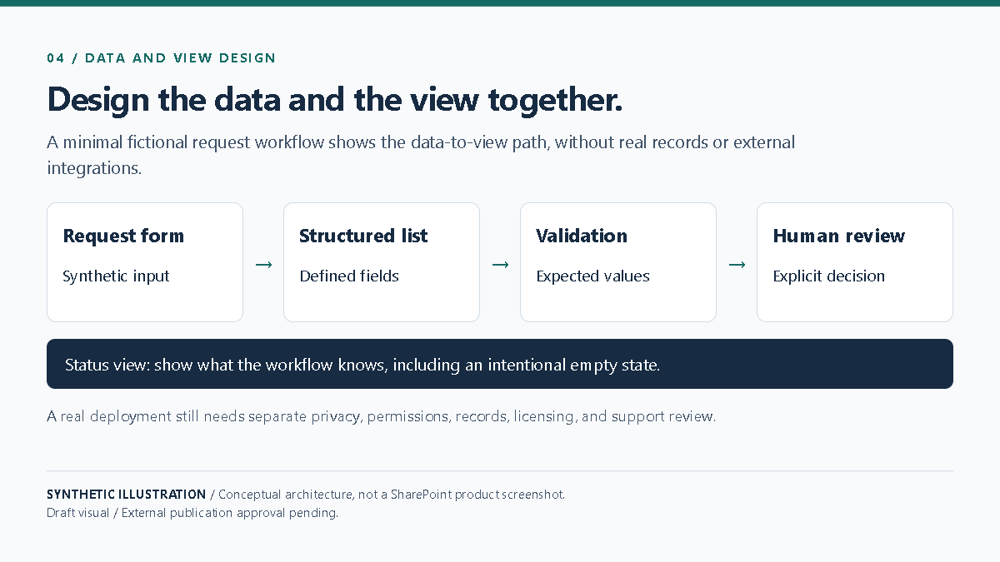

# Designing SharePoint Solutions with Explicit Contracts

SharePoint lists, libraries, and pages work best when their data and use are designed together. Before building, define the fields, required values, views, metadata, access model, and page purpose. Include only the data the workflow needs, and make ownership and lifecycle decisions explicit.

A synthetic event check-in example can use anonymous records and an aggregate count. Its design needs no personal details or external integration. The demonstration can show how a field maps to a view and how an empty state is presented, while a human remains responsible for configuration and release.

Real deployments require their own privacy, records, licensing, security, and support reviews. This simplified scenario intentionally omits those implementation details and does not describe any pilot or client architecture.

**Limitation:** The minimal synthetic schema is not a deployment design; production data, permissions, retention, and support need separate review.

**Visual:** Playwright capture EVD-BLOG-004; [source and capture notes](assets/README.md).

**Caption:** A fictional data-to-view path with an explicit human decision point; not a SharePoint product screenshot.

**Source note:** Original synthetic illustration in this repository; external publication approval pending.
