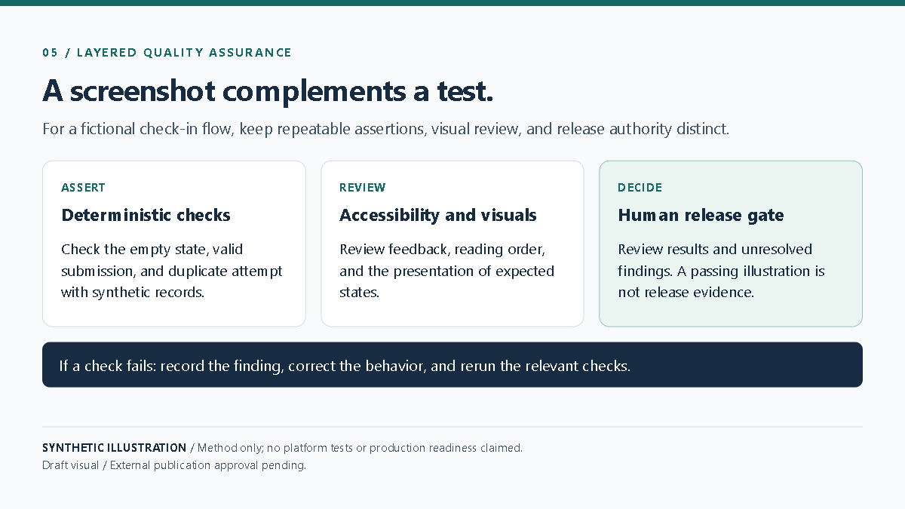

# A Layered QA System for Low-Code Solutions

Quality checks should match the risk and be repeatable. Begin with deterministic validation for required fields, formulas, and expected states. Add functional and accessibility checks for user journeys. Use visual review as a complement, not a replacement for assertions. Keep exploratory computer use bounded, and preserve human authority over release.

In a fictional check-in flow, a test verifies an empty state, a valid submission, and a duplicate attempt using synthetic records. An accessibility review notices that an updated count is not announced. The developer corrects the feedback and reruns the relevant checks. The release decision remains with a human.

That is a demonstration of a method, not a real defect report. Public examples should never reuse internal bug history, application screens, or environment details; recreate the scenario in a safe demonstration environment.

**Limitation:** A passing synthetic test set does not prove production readiness or replace risk-based human review.

**Visual:** Playwright capture EVD-BLOG-005; [source and capture notes](assets/README.md).

**Caption:** Synthetic QA responsibilities and correction process; this illustration is not evidence of executed platform tests.

**Source note:** Original synthetic diagram and failure scenario in this repository; external publication approval pending.
