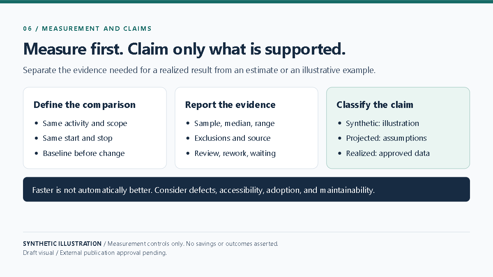

# Measuring Whether AI Improved Delivery

A credible improvement claim starts before a change is introduced. Define the activity, start and stop events, comparable work, data source, and sample size. Report the median and range, describe exclusions, and separate generation, human review, rework, waiting, and deployment time.

For illustration only, imagine a fictional exercise with ten comparable tasks and a hypothetical baseline of 50 minutes per task. A proposed workflow might estimate 40 minutes, but those numbers are invented scenario inputs—not observed data, a forecast backed by a pilot, or a realized result. They cannot support a claim of improvement.

A real result would require approved source evidence and a like-for-like comparison. Adoption, defects, accessibility, and maintainability also matter; a faster task is not automatically a better outcome. Label estimates as projections, show assumptions, and do not convert them into realized benefits.

**Limitation:** A small or non-comparable sample cannot support a causal or organization-wide claim, even when the arithmetic is correct.

**Visual:** Playwright capture EVD-BLOG-006; [source and capture notes](assets/README.md).

**Caption:** Measurement controls for distinguishing realized outcomes from projections; no results are asserted.

**Source note:** Original synthetic diagram and hypothetical numbers in this article; no pilot data used. External publication approval pending.
