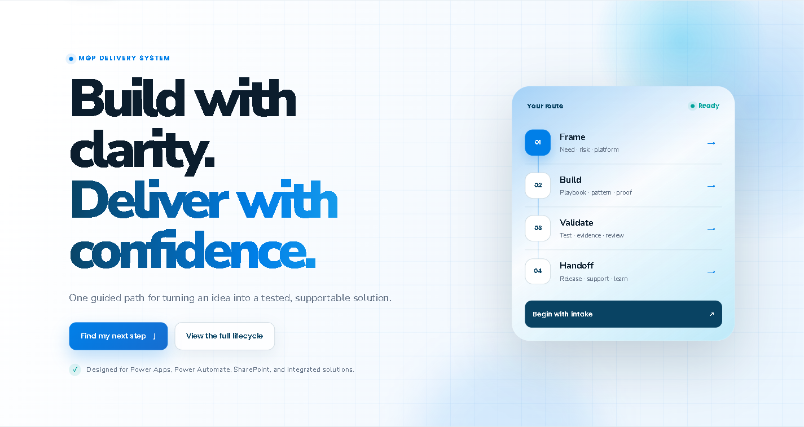
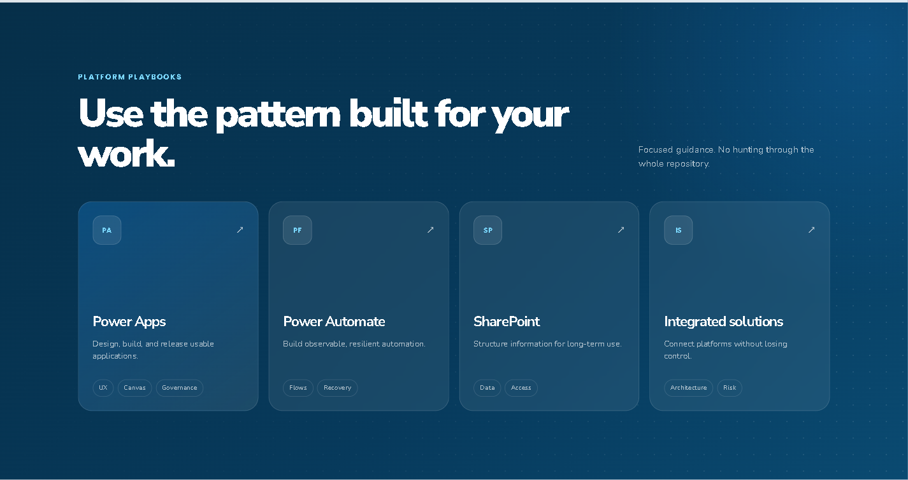
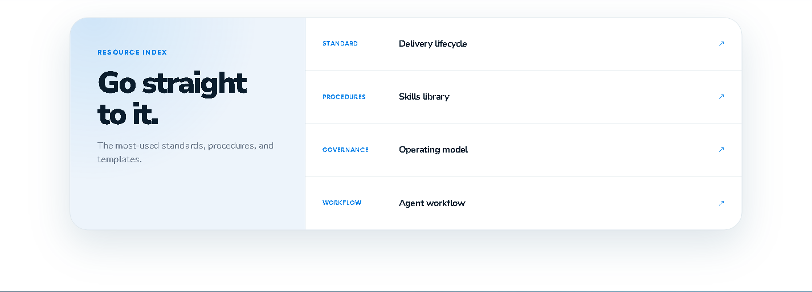
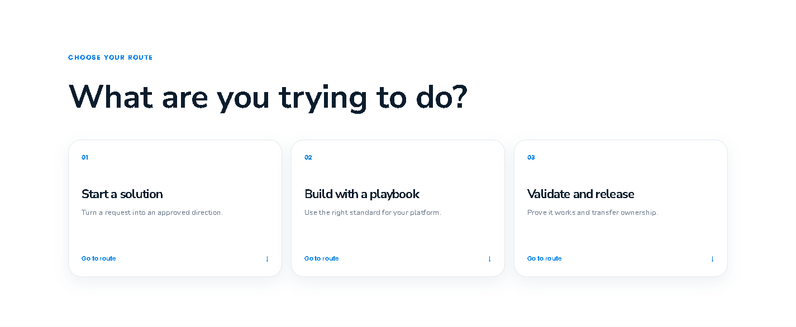
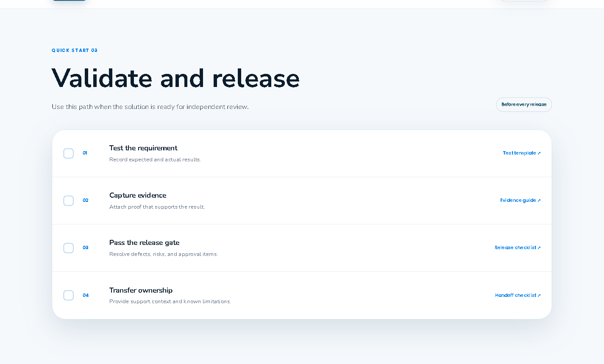
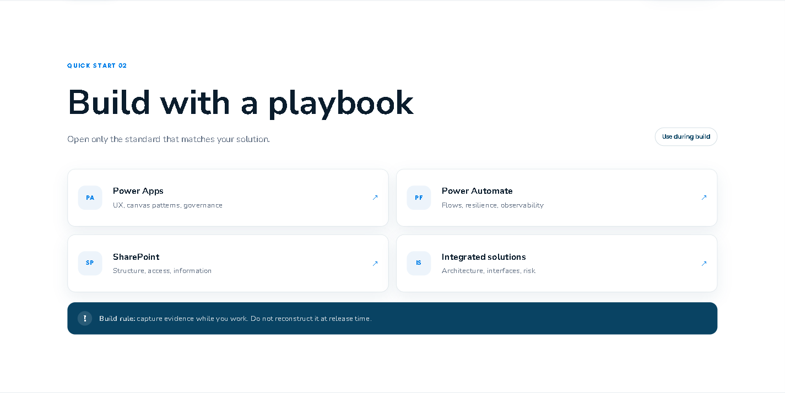

# Training Video Storyboard Assets

These screenshots support the 90-second MGP Developer Delivery Guide orientation video.

## Sequence

### 1. Establish the delivery route

**Narration:** The MGP Developer Delivery Guide gives every solution one clear path from request to handoff.

### 2. Choose the platform playbook

**Narration:** Open the playbook for your platform. You do not need to read the entire repository.

### 3. Jump directly to a resource

**Narration:** Experienced developers can go directly to the standard, procedure, governance model, or workflow they need.

### 4. Choose a quick-start route

**Narration:** New developers can choose one route: start a solution, build with a playbook, or validate and release.

### 5. Follow the release checklist

**Narration:** Before release, test the requirement, capture evidence, pass the release gate, and transfer ownership.

### 6. Use the focused platform standard

**Narration:** During build, open only the standard that matches the solution and capture evidence as the work happens.

## Editing notes

- Use a 1920×1080 timeline.
- Fit each screenshot within the safe title area rather than stretching it.
- Use slow pan and zoom movement only when it reinforces the narration.
- Keep each frame visible long enough to read the primary heading.
- Add captions and provide a transcript.
- Do not add client information, credentials, environment identifiers, or production data.
- Replace screenshots if the page structure or labels change materially.
