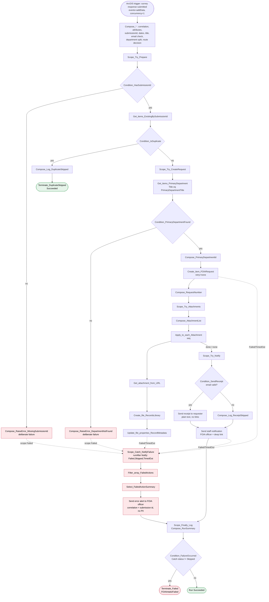

# Flow Design — FOIA Public Intake (Survey123 → SharePoint)

| | |
|---|---|
| Flow display name | `FOIA Pilot - Public Intake (Survey123 to SharePoint)` |
| Pilot | Flossmoor FOIA — synthetic data only, Community Essentials dev tenant |
| Owner | FOIA pilot delivery lead (MGP); run-as identity = FOIA service account (placeholder) |
| Status | DESIGN — not deployed. See `README.md` for manual deployment. |
| Standard | `standards/power-automate.md`, `standards/visual-verification.md` |
| Companion files | `survey123-schema.md`, `flow-definition.json`, `test-plan.md`, `README.md` |

## 1. Purpose and effects

Receive each public FOIA submission from the Survey123 form, create exactly one row in
`FOIA Pilot Requests`, file any fee-waiver attachment into `FOIA Pilot Records`, send the
requester a receipt, and notify the FOIA officer. Nothing is deleted or updated by this flow
except the metadata of files it just created.

Downstream effects per run (happy path): 1 SharePoint item created, 0..n files created
and tagged, 0..1 receipt email, 1 staff email. Nothing else.

Out of scope by decision (separate flows later): holidays, extensions, reminders,
retention/deletion, department CCs, dead-letter list.

## 2. Trigger

| | |
|---|---|
| Connector | **ArcGIS** (`shared_arcgis`) — *not* the deprecated Survey123 connector |
| Operation | **When a survey response is submitted** (operationId `AddData`, webhook) |
| surveyId | Survey123 form item ID — environment variable `mgp_FOIASurvey123FormItemId` |
| events | `["addData"]` only. Edits/deletes are not subscribed. |
| includeServiceRequest | `true` — provides `feature.attributes`, `feature.result`, `feature.attachments` |
| includeSurveyInfo | `true` — `surveyInfo.formTitle`, `serviceUrl` for the run log |
| includeUserInfo | `false` — public/anonymous form; do not collect submitter identity |
| includePortalInfo | `false` |
| includeServiceResponse | `false` |
| Concurrency | `runs: 1` (trigger concurrency control). Pilot volume is low; serialising runs makes the idempotency check race-free. **Cannot be switched off later without re-creating the trigger** — accepted. |

Expected payload shape used by the flow (verify against the first real trigger sample and
record it as evidence — field casing matters):

```jsonc
{
  "eventType": "addData",
  "surveyInfo": { "formItemId": "…", "formTitle": "Village FOIA Request (Pilot)", "serviceUrl": "…/FeatureServer" },
  "feature": {
    "attributes": {
      "objectid": 17, "globalid": "{A1B2…}",
      "RequesterFirstName": "…", "RequesterLastName": "…", "RequesterEmail": "…", "RequesterPhone": "…",
      "RequesterStreetAddress": "…", "RequesterCity": "…", "RequesterState": "…", "RequesterZip": "…",
      "RequestDescription": "…", "Departments": "Police_Department,Finance",
      "CommercialPurpose": "No", "DeliveryFormat": "Electronic", "CertifiedCopies": "No", "FeeWaiverRequested": "Yes"
    },
    "result": { "objectId": 17, "globalId": "{A1B2…}", "success": true },
    "attachments": {
      "FeeWaiverStatement": [
        { "id": 3, "globalId": "{…}", "name": "statement.pdf", "contentType": "application/pdf", "size": 48213,
          "url": "https://services…/FeatureServer/0/17/attachments/3", "keywords": "FeeWaiverStatement" }
      ]
    }
  }
}
```

## 3. Connection references and environment variables (names only — no values)

Connection references (solution-aware; bind at import):

| Logical name | Connector | Used by | Identity |
|---|---|---|---|
| `mgp_FOIA_ArcGIS` | `shared_arcgis` | Trigger, `Get_attachment_from_URL` | ArcGIS org account that owns the survey |
| `mgp_FOIA_SharePoint` | `shared_sharepointonline` | all `Get items`, `Create item`, `Create file`, `Update file properties` | FOIA service account with Contribute on the three lists/library |
| `mgp_FOIA_Office365Outlook` | `shared_office365` | all three email actions | FOIA service account with **Send As** on the shared mailbox |

Inside the definition the host of every action is `connectionName: "shared_<api>"`, which the
platform resolves through `@parameters('$connections')['shared_<api>']['connectionId']` and the
`connectionReferences` block maps to the logical names above.

Environment variables (schema name, type, purpose):

| Name | Type | Purpose |
|---|---|---|
| `mgp_FOIASiteUrl` | Text | `https://communityessentials.sharepoint.com/sites/Administration` |
| `mgp_FOIARequestsListId` | Text | GUID of `FOIA Pilot Requests` (`f99e0269-3061-4892-87ac-3dabba92d416`) |
| `mgp_FOIADepartmentsListId` | Text | GUID of `FOIA Pilot Departments` (`afbfa1b0-47ef-41dc-ac89-32ba142ddeef`) |
| `mgp_FOIARecordsLibraryId` | Text | GUID of `FOIA Pilot Records` (`2b47c60b-057c-498d-ab75-0097a8abeb74`) |
| `mgp_FOIARecordsLibraryFolderPath` | Text | Server-relative folder for `Create file`, e.g. `/FOIA Pilot Records` |
| `mgp_FOIASharedMailbox` | Text | Sending mailbox, e.g. `foia@<client>.example` |
| `mgp_FOIAOfficerEmail` | Text | FOIA officer notification/alert recipient |
| `mgp_FOIAAppDeepLinkBaseUrl` | Text | Canvas app play URL incl. `?tenantId=…`; flow appends `&RequestId=<ID>` |
| `mgp_FOIATimeZone` | Text | `Central Standard Time` (Windows ID; handles CDT automatically) |
| `mgp_FOIASurvey123FormItemId` | Text | Survey123 form item ID used by the trigger |

GUIDs are listed here for traceability only; the definition reads them from environment
variables so test/prod bind differently without editing the flow.

## 4. Action sequence

Naming: `<Type>_<WhatItDoes>`. Every action below is a top-level action or lives inside the
named scope. Run-after is "Succeeded" from the previous action unless stated.

### 4.1 Pre-scope composes (run-after: trigger)

| # | Action | Type | Inputs / expression |
|---|---|---|---|
| 1 | `Compose_CorrelationId` | Compose | `@{workflow()?['run']?['name']}` — the run ID; carried into every email and the log |
| 2 | `Compose_Attributes` | Compose | `@triggerBody()?['feature']?['attributes']` |
| 3 | `Compose_SubmissionId` | Compose | `@{coalesce(outputs('Compose_Attributes')?['globalid'], outputs('Compose_Attributes')?['GlobalID'], triggerBody()?['feature']?['result']?['globalId'], if(empty(outputs('Compose_Attributes')?['objectid']), '', string(outputs('Compose_Attributes')?['objectid'])))}` |
| 4 | `Compose_ReceivedDate` | Compose | `@{convertFromUtc(utcNow(), parameters('mgp_FOIATimeZone (mgp_FOIATimeZone)'), 'yyyy-MM-dd')}` |
| 5 | `Compose_DueDateSuggested` | Compose | see §6 |
| 6 | `Compose_RequesterFirstName` | Compose | `@{trim(coalesce(outputs('Compose_Attributes')?['RequesterFirstName'], ''))}` |
| 7 | `Compose_RequesterLastName` | Compose | `@{trim(coalesce(outputs('Compose_Attributes')?['RequesterLastName'], ''))}` |
| 8 | `Compose_RequestTitle` | Compose | `@{if(and(empty(outputs('Compose_RequesterLastName')), empty(outputs('Compose_RequesterFirstName'))), 'Anonymous request', if(empty(outputs('Compose_RequesterFirstName')), outputs('Compose_RequesterLastName'), if(empty(outputs('Compose_RequesterLastName')), outputs('Compose_RequesterFirstName'), concat(outputs('Compose_RequesterLastName'), ', ', outputs('Compose_RequesterFirstName')))))}` |
| 9 | `Compose_RequesterEmail` | Compose | `@{toLower(trim(coalesce(outputs('Compose_Attributes')?['RequesterEmail'], '')))}` |
| 10 | `Compose_IsRequesterEmailValid` | Compose | see §7 |
| 11 | `Select_DepartmentTitles` | Select | From `@split(coalesce(outputs('Compose_Attributes')?['Departments'], ''), ',')`; Map `@replace(trim(item()), '_', ' ')` |
| 12 | `Filter_array_DepartmentTitles` | Filter array | From `@body('Select_DepartmentTitles')`; where `@not(empty(item()))` |
| 13 | `Compose_RouteDecision` | Compose | see §5 |
| 14 | `Compose_PrimaryDepartmentTitle` | Compose | see §5 |

### 4.2 `Scope_Try_Prepare` — guards and idempotency

| # | Action | Type | Inputs |
|---|---|---|---|
| 15 | `Condition_HasSubmissionId` | Condition | `@not(empty(outputs('Compose_SubmissionId')))` |
| 15a | └ false → `Compose_RaiseError_MissingSubmissionId` | Compose | `@{int(concat('MissingSubmissionId: payload had no globalid/objectid. Correlation ', outputs('Compose_CorrelationId')))}` — **deliberately fails** (`int()` of text) so the single Catch scope handles it with a readable message. Without an ID the flow cannot be idempotent, so it must not create anything. |
| 16 | `Get_items_ExistingBySubmissionId` | SharePoint **Get items** (`GetItems`) | dataset = site; table = Requests list; `$filter` = `SourceSubmissionId eq '@{outputs('Compose_SubmissionId')}'`; `$top` = 1 |
| 17 | `Condition_IsDuplicate` | Condition | `@greater(length(body('Get_items_ExistingBySubmissionId')?['value']), 0)` |
| 17a | └ true → `Compose_Log_DuplicateSkipped` | Compose | `{ correlationId, submissionId, existingRequestId: first(...)?['ID'], outcome: 'DuplicateSkipped' }` |
| 17b | └ true → `Terminate_DuplicateSkipped` | Terminate | status **Succeeded**. Webhook retries and manual resubmits end here with no side effects. |

### 4.3 `Scope_Try_CreateRequest` (run-after Prepare: Succeeded)

| # | Action | Type | Inputs |
|---|---|---|---|
| 18 | `Get_items_PrimaryDepartment` | SharePoint **Get items** | table = Departments list; `$filter` = `Title eq '@{replace(outputs('Compose_PrimaryDepartmentTitle'), '''', '''''')}'`; `$top` = 1 |
| 19 | `Condition_PrimaryDepartmentFound` | Condition | `@greater(length(body('Get_items_PrimaryDepartment')?['value']), 0)` |
| 19a | └ false → `Compose_RaiseError_DepartmentNotFound` | Compose | `@{int(concat('DepartmentNotFound: ', outputs('Compose_PrimaryDepartmentTitle')))}` — deliberate failure → Catch. The submission stays in the Survey123 feature layer; after fixing the Departments list the officer resubmits the run. |
| 20 | `Compose_PrimaryDepartmentId` | Compose | `@{first(body('Get_items_PrimaryDepartment')?['value'])?['ID']}` |
| 21 | `Create_item_FOIARequest` | SharePoint **Create item** (`PostItem`) | **retryPolicy: none** (a retried POST after a timed-out success would create a duplicate; the webhook/resubmit path is already idempotent). Fields in §8. |
| 22 | `Compose_RequestNumber` | Compose | `@{body('Create_item_FOIARequest')?['ID']}` |

### 4.4 `Scope_Try_Attachments` (run-after CreateRequest: Succeeded)

| # | Action | Type | Inputs |
|---|---|---|---|
| 23 | `Compose_AttachmentList` | Compose | `@coalesce(triggerBody()?['feature']?['attachments']?['FeeWaiverStatement'], json('[]'))` |
| 24 | `Apply_to_each_Attachment` | Apply to each | over `@outputs('Compose_AttachmentList')`; concurrency **1** (sequential; file names stay ordered, SharePoint not hammered). Zero items → loop body skipped, scope succeeds. |
| 24a | └ `Get_attachment_from_URL` | ArcGIS **Get attachment from URL** (`GetAttachmentFromUrl`) | `attachmentUrl` = `@items('Apply_to_each_Attachment')?['url']`; timeout PT2M |
| 24b | └ `Create_file_RecordsLibrary` | SharePoint **Create file** (`CreateFile`) | folderPath = `mgp_FOIARecordsLibraryFolderPath`; name = `@{outputs('Compose_RequestNumber')}-FeeWaiver-@{items('Apply_to_each_Attachment')?['id']}-@{items('Apply_to_each_Attachment')?['name']}`; body = `@body('Get_attachment_from_URL')`; timeout PT2M |
| 24c | └ `Update_file_properties_RecordMetadata` | SharePoint **Update file properties** (`PatchFileItem`) | table = Records library; id = `@body('Create_file_RecordsLibrary')?['ItemId']`; `Title` = file name; `Request/Id` = request number; `DocumentType/Value` = `Request`; `RedactionStatus/Value` = `Not Reviewed`; `Sensitivity/Value` = `Internal`; `IsFinalResponse` = `false`; `Notes` = `Fee waiver statement submitted with the online request. Source attachment id <id>.` |

### 4.5 `Scope_Try_Notify` (run-after Attachments: Succeeded)

Only reached when the item exists and attachments (if any) are filed — so a receipt can
never be sent for a failed create (decision 10).

| # | Action | Type | Inputs |
|---|---|---|---|
| 25 | `Condition_SendReceipt` | Condition | `@equals(outputs('Compose_IsRequesterEmailValid'), true)` |
| 25a | └ true → `Send_an_email_from_a_shared_mailbox_Receipt` | Office 365 Outlook **Send an email from a shared mailbox (V2)** (`SharedMailboxSendEmailV2`) | from `mgp_FOIASharedMailbox`; to `Compose_RequesterEmail`; subject `FOIA request received - #<RequestNumber>`; body §9.1 — plain text, **no links** |
| 25b | └ false → `Compose_Log_ReceiptSkipped` | Compose | `{ correlationId, requestNumber, reason: 'RequesterEmail blank or invalid format' }` |
| 26 | `Send_an_email_from_a_shared_mailbox_StaffNotification` | same connector/operation | to `mgp_FOIAOfficerEmail`; subject `New FOIA request #<n> - <Route> - <PrimaryDepartment>`; body §9.2 with deep link. No department CCs in Phase 1. |

### 4.6 `Scope_Catch_NotifyFailure` (run-after `Scope_Try_Notify`: **Failed, Skipped, TimedOut**)

"Skipped" is required: if `Scope_Try_Prepare` fails, every later Try scope is skipped and the
Catch must still fire.

| # | Action | Type | Inputs |
|---|---|---|---|
| 27 | `Filter_array_FailedActions` | Filter array | From `@union(result('Scope_Try_Prepare'), result('Scope_Try_CreateRequest'), result('Scope_Try_Attachments'), result('Scope_Try_Notify'))`; where `@or(equals(item()?['status'], 'Failed'), equals(item()?['status'], 'TimedOut'))`. `_todo`: confirm `result()` on a skipped scope returns `[]` rather than throwing (TC-12); fall back to four per-scope Composes with run-after Skipped if it throws. |
| 28 | `Select_FailedActionSummary` | Select | map `{ action: item()?['name'], status: item()?['status'], code: item()?['error']?['code'], message: item()?['error']?['message'] }` |
| 29 | `Send_an_email_from_a_shared_mailbox_ErrorAlert` | Office 365 Outlook | to `mgp_FOIAOfficerEmail`; importance High; subject `FOIA intake flow FAILED - correlation <id>`; body §9.3 — correlation ID, submission ID, request number if created (via `actions('Create_item_FOIARequest')?['outputs']?['body']?['ID']`), failed action summary, run link. **No requester PII.** |

### 4.7 `Scope_Finally_Log` (run-after Catch: Succeeded, Failed, Skipped, TimedOut)

| # | Action | Type | Inputs |
|---|---|---|---|
| 30 | `Compose_RunSummary` | Compose | `{ correlationId, submissionId, receivedDate, route, primaryDepartment, dueDateSuggested, requestNumber: actions('Create_item_FOIARequest')?['outputs']?['body']?['ID'], attachmentCount: length(outputs('Compose_AttachmentList')) via actions(), receiptStatus: actions('Send_an_email_from_a_shared_mailbox_Receipt')?['status'], staffNotifyStatus: actions('…StaffNotification')?['status'], catchStatus: actions('Scope_Catch_NotifyFailure')?['status'] }` — the one place support looks first in run history. Uses `actions()` not `outputs()` so skipped actions resolve to null instead of erroring. |

### 4.8 Final status (run-after Finally: Succeeded, Failed)

| # | Action | Type | Inputs |
|---|---|---|---|
| 31 | `Condition_FailureOccurred` | Condition | `@not(equals(actions('Scope_Catch_NotifyFailure')?['status'], 'Skipped'))` |
| 31a | └ true → `Terminate_Failed` | Terminate | status **Failed**; code `FOIAIntakeFailed`; message `Intake failed. Correlation <id>. Submission <submissionId>. See error alert email.` — guarantees a handled failure is never reported as Succeeded, even if the alert email itself failed. |

## 5. Routing table

Input: `Filter_array_DepartmentTitles` = the de-underscored, non-empty department titles.

| Count | Content | `RequestRoute` | `PrimaryDepartment` (lookup by Title) |
|---|---|---|---|
| 0 | — | `Unassigned` | `Administration` |
| 1 | `Police Department` | `Police` | `Police Department` |
| 1 | any other single title | `Non-Police` | that title |
| ≥2 | any mix (incl. Police) | `Multi-Department` | `Administration` (FOIA officer triages) |

```
Compose_RouteDecision =
@{if(equals(length(body('Filter_array_DepartmentTitles')), 0), 'Unassigned',
   if(greater(length(body('Filter_array_DepartmentTitles')), 1), 'Multi-Department',
      if(equals(first(body('Filter_array_DepartmentTitles')), 'Police Department'), 'Police', 'Non-Police')))}

Compose_PrimaryDepartmentTitle =
@{if(equals(outputs('Compose_RouteDecision'), 'Non-Police'), first(body('Filter_array_DepartmentTitles')),
   if(equals(outputs('Compose_RouteDecision'), 'Police'), 'Police Department', 'Administration'))}
```

The lookup ID is always resolved at run time by `Get_items_PrimaryDepartment` (filter on
`Title`, `$top 1`). No department IDs are hardcoded. A title not present in the list is a
configuration failure → Catch (decision 3).

## 6. Due-date algorithm (suggest-and-confirm)

Rule: 5 business days from `ReceivedDate`, skipping Saturday and Sunday only. Written to
`DueDate` with `DueDateConfirmed = false`. A human confirms in the app; the flow never sets
`true`.

Closed form — no loop needed. Five business days from any weekday lands on the same weekday
one week later (+7). A Saturday receipt is treated as received Monday (+2) then +7 = +9; a
Sunday receipt is Monday (+1) then +7 = +8.

```
Compose_DueDateSuggested =
@{addDays(outputs('Compose_ReceivedDate'),
   if(equals(dayOfWeek(outputs('Compose_ReceivedDate')), 6), 9,
      if(equals(dayOfWeek(outputs('Compose_ReceivedDate')), 0), 8, 7)),
   'yyyy-MM-dd')}
```

`dayOfWeek` returns 0 = Sunday … 6 = Saturday.

| ReceivedDate | Day | DueDate | Check |
|---|---|---|---|
| 2026-10-12 | Mon | 2026-10-19 | Tue Wed Thu Fri Mon ✓ |
| 2026-10-16 | Fri | 2026-10-23 | Mon Tue Wed Thu Fri ✓ |
| 2026-10-17 | Sat | 2026-10-26 | received Mon 19 → Mon 26 ✓ |
| 2026-10-18 | Sun | 2026-10-26 | received Mon 19 → Mon 26 ✓ |

**Known limitation:** Village holidays, commercial-purpose timelines (21 days), and
statutory extensions are *not* applied. That is why the date is a suggestion and the
`DueDateConfirmed` flag exists. `ReceivedDate` is the Central-time date at the moment the
webhook fires, not the Survey123 device time.

## 7. Requester-email validation (no regex available)

```
Compose_IsRequesterEmailValid =
@{and(
   not(empty(outputs('Compose_RequesterEmail'))),
   greater(length(outputs('Compose_RequesterEmail')), 5),
   equals(length(split(outputs('Compose_RequesterEmail'), '@')), 2),
   not(contains(outputs('Compose_RequesterEmail'), ' ')),
   not(startsWith(outputs('Compose_RequesterEmail'), '@')),
   contains(last(split(outputs('Compose_RequesterEmail'), '@')), '.'),
   not(startsWith(last(split(outputs('Compose_RequesterEmail'), '@')), '.')),
   not(endsWith(outputs('Compose_RequesterEmail'), '.'))
)}
```

Accepts `a@b.co`; rejects blank, `nobody`, `@x.com`, `a@b`, `a b@c.com`, `a@.com`, `a@b.`.
Not RFC 5322; good enough to avoid a guaranteed bounce. The raw value is still written to
the list unchanged so staff can correct it.

## 8. `Create_item_FOIARequest` field map

| SharePoint field (parameter key) | Value |
|---|---|
| `item/Title` | `@{outputs('Compose_RequestTitle')}` |
| `item/ReceivedDate` | `@{outputs('Compose_ReceivedDate')}` |
| `item/IntakeMethod/Value` | `Online Form` |
| `item/RequestRoute/Value` | `@{outputs('Compose_RouteDecision')}` |
| `item/RequestDescription` | `@{outputs('Compose_Attributes')?['RequestDescription']}` |
| `item/OverallStatus/Value` | `New` |
| `item/CommercialPurpose/Value` | `@{coalesce(outputs('Compose_Attributes')?['CommercialPurpose'], 'No')}` |
| `item/RequesterFirstName` | `@{outputs('Compose_RequesterFirstName')}` |
| `item/RequesterLastName` | `@{outputs('Compose_RequesterLastName')}` |
| `item/RequesterStreetAddress` … `item/RequesterZip` | attribute passthrough |
| `item/RequesterEmail` | `@{outputs('Compose_RequesterEmail')}` |
| `item/RequesterPhone` | attribute passthrough |
| `item/DeliveryFormat/Value` | `@{coalesce(outputs('Compose_Attributes')?['DeliveryFormat'], 'Electronic')}` |
| `item/CertifiedCopies/Value` | `@{coalesce(outputs('Compose_Attributes')?['CertifiedCopies'], 'No')}` |
| `item/FeeWaiverRequested/Value` | `@{coalesce(outputs('Compose_Attributes')?['FeeWaiverRequested'], 'No')}` |
| `item/DueDate` | `@{outputs('Compose_DueDateSuggested')}` |
| `item/DueDateConfirmed` | `false` |
| `item/PrimaryDepartment/Id` | `@{outputs('Compose_PrimaryDepartmentId')}` |
| `item/SourceSubmissionId` | `@{outputs('Compose_SubmissionId')}` |
| `item/CurrentStageNotes` | `Created by online intake flow. Correlation @{outputs('Compose_CorrelationId')}. Departments selected: @{join(body('Filter_array_DepartmentTitles'), '; ')}. Due date is a suggestion (5 business days, no holidays) pending staff confirmation.` |

Not set: AssignedOfficer, Extension*, FinalResponseDate, CloseoutNotes.

`_todo` before first run: confirm the exact choice values exist on the list for
`RequestRoute` (`Police`, `Non-Police`, `Multi-Department`, `Unassigned`), `IntakeMethod`
(`Online Form`), `OverallStatus` (`New`), and on the library for `DocumentType` (`Request`),
`RedactionStatus` (`Not Reviewed`), `Sensitivity` (`Internal`). The canvas app's
RequestDetail screen currently renders `RequestRoute` as a *stage* (Intake / Department
Review / …); that mismatch is an app finding to raise with the app owner, not something this
flow resolves.

## 9. Email content

All three use **Send an email from a shared mailbox (V2)**, `MailboxAddress` =
`mgp_FOIASharedMailbox`. Bodies are plain text (line breaks only; no HTML styling).

### 9.1 Receipt to requester (no links, no internal names)

```
Subject: FOIA request received - #@{outputs('Compose_RequestNumber')}

Thank you. Your Freedom of Information Act request has been received.

Request number: @{outputs('Compose_RequestNumber')}
Received: @{outputs('Compose_ReceivedDate')}
Summary: @{substring(outputs('Compose_Attributes')?['RequestDescription'], 0, min(300, length(outputs('Compose_Attributes')?['RequestDescription'])))}

Staff will review your request and confirm the response date. Please reference your
request number in any follow-up.

This mailbox is monitored by the FOIA officer.
```

### 9.2 Staff notification (FOIA officer only)

```
Subject: New FOIA request #<n> - <Route> - <PrimaryDepartment>

A new public FOIA request was created by the online intake flow.

Request number: <n>
Requester: <Title>
Route: <RequestRoute>
Primary department: <PrimaryDepartmentTitle>
Received: <ReceivedDate>
Suggested due date (unconfirmed, 5 business days, no holidays): <DueDateSuggested>
Attachments filed: <count>
Receipt email: <Sent | Skipped - no valid email>

Open in app: @{parameters('mgp_FOIAAppDeepLinkBaseUrl …')}&RequestId=<n>

Correlation: <CorrelationId>
```

### 9.3 Error alert (FOIA officer only — no requester PII)

```
Subject: FOIA intake flow FAILED - correlation <CorrelationId>

The online FOIA intake flow failed and needs attention.

Correlation ID (run): <CorrelationId>
Source submission ID: <SubmissionId>
Request number: <ID | not created>
Route / primary department (computed): <Route> / <PrimaryDepartmentTitle>
Failed actions: <JSON from Select_FailedActionSummary>

Run detail: https://make.powerautomate.com/environments/@{workflow()?['tags']?['environmentName']}/flows/@{workflow()?['name']}/runs/@{workflow()?['run']?['name']}

If the request number is "not created", the submission is still in Survey123; fix the
cause and resubmit the run. If a request number is shown, the row exists — check
attachments and notifications manually before resubmitting (a resubmit will be skipped as
a duplicate).
```

## 10. Idempotency, concurrency, retries, timeouts

| Concern | Decision |
|---|---|
| Duplicate prevention | `SourceSubmissionId` = Survey123 `globalid`. `Get items` filter before create; duplicate → `Terminate Succeeded`, no side effects. |
| Concurrency | Trigger concurrency = 1 run. Two submissions arriving together are processed in order; the second sees the first's row. |
| Create retry | `Create_item_FOIARequest` retryPolicy **none**. Everything else: platform default (exponential, 4). |
| Timeouts | `Get_attachment_from_URL`, `Create_file_RecordsLibrary`: PT2M. |
| Throttling | ≤ 6 SharePoint calls per run + 2 per attachment; well under limits at pilot volume. Loop concurrency 1. |
| Pagination | `$top 1` on both Get items; no paging needed. |
| Partial failure | Item created but attachment/notify failed → Catch → error alert includes request number → run Failed. Recovery is manual (upload attachment / resend from app). Resubmit will not re-create the row (idempotent) and will **not** re-file attachments — known limitation. |
| Correlation | `Compose_CorrelationId` = run ID, stamped into `CurrentStageNotes`, every email, and `Compose_RunSummary`. |
| Logging | `Compose_RunSummary` in Finally; `Compose_Log_*` on skip paths. No dead-letter list (decision 10). |
| Alerting | Error alert email to officer; flow run status Failed → visible in flow analytics / "Flow failed" platform notifications. |
| Secrets | None in the definition. Mailbox and recipient addresses are environment variables. |

## 11. Flowchart



## 12. Dependency inventory

| Dependency | Type | Owner | Impact if changed |
|---|---|---|---|
| Survey123 form `Village FOIA Request (Pilot)` | ArcGIS item | GIS admin | Renaming a question breaks the 1:1 map; adding an attachment question needs a flow change |
| `FOIA Pilot Requests` list and choice values | SharePoint | FOIA pilot lead | Choice value rename → Create item fails (Catch) |
| `FOIA Pilot Departments` list titles | SharePoint | FOIA pilot lead | Title rename → DepartmentNotFound (Catch) until the survey choice label/name is updated |
| `FOIA Pilot Records` library + folder path | SharePoint | FOIA pilot lead | Folder move → Create file fails |
| FOIA shared mailbox + Send As | Exchange | M365 admin | Missing Send As → every email fails; run Failed |
| Canvas app `FOIA App` (`afe38862-8f10-4548-802f-c8d4c8d6603e`) | Power Apps | App owner | Deep link only; app does not yet read `Param("RequestId")` — follow-up |

## 13. Known limitations (carry into README)

1. Weekend-only business-day rule; no holidays, no commercial 21-day rule — human confirms.
2. One attachment question (`FeeWaiverStatement`) is read; others are ignored.
3. Email validation is heuristic, not RFC.
4. Resubmitting a run after a partial failure does not re-file attachments or resend emails.
5. Trigger concurrency = 1 cannot be removed without re-creating the trigger.
6. Error alert includes connector error messages, which could in rare cases echo a field
   value; SharePoint validation errors name columns, not values. Reviewed as acceptable for
   pilot; revisit before production.
7. `result()` behaviour on skipped scopes must be confirmed in TC-12.
