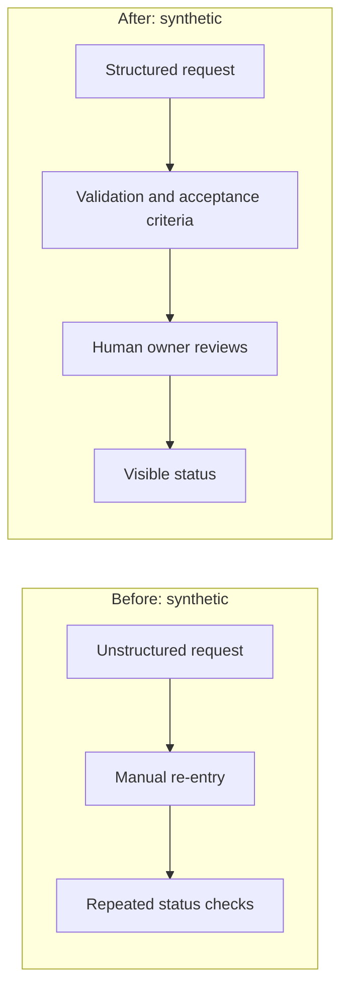
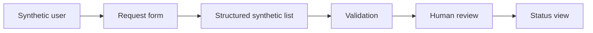
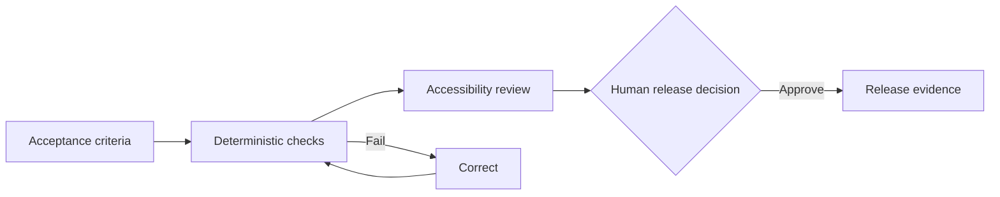
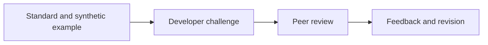
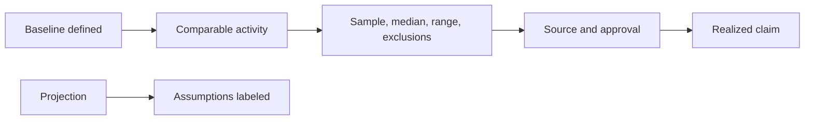

# Synthetic Portfolio Visuals

All diagrams below are original, fictional process illustrations. They are not screenshots or reconstructions of pilot systems. Source: synthetic examples authored for this repository. Publication approval for an external venue is still required.

## Before and after process

**Alt text:** Before, a fictional training request arrives as an unstructured message and is manually re-entered into a tracker. After, a structured request is checked against acceptance criteria, validated, and routed to a human owner.

**Caption:** A synthetic example of moving from informal intake to a validated, human-owned workflow; it does not show measured time savings.

## Architecture

**Alt text:** A fictional request form sends synthetic data to a structured list, where validation and a human review step precede a status view. No external integrations are shown.

**Caption:** Minimal synthetic architecture with an explicit human decision point.

## QA

**Alt text:** Synthetic requirements map to deterministic checks, accessibility review, and a human release decision. A failed check loops through correction and rerun.

**Caption:** A fictional QA path that makes the correction and human release gate visible.

## Adoption

**Alt text:** A fictional developer studies an approved example, completes a bounded synthetic challenge, receives peer review, and records feedback for a later revision.

**Caption:** Proposed independent-reuse evidence path; no training completion or independent success is claimed.

## Outcome evidence

**Alt text:** A baseline and comparable activity are measured with a stated sample, median, range, exclusions, and source before any realized outcome is reported. Projections are shown separately.

**Caption:** Measurement and claim controls; no values or realized benefit are asserted.

